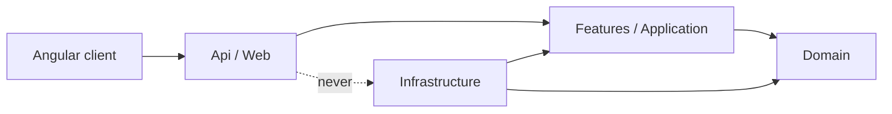
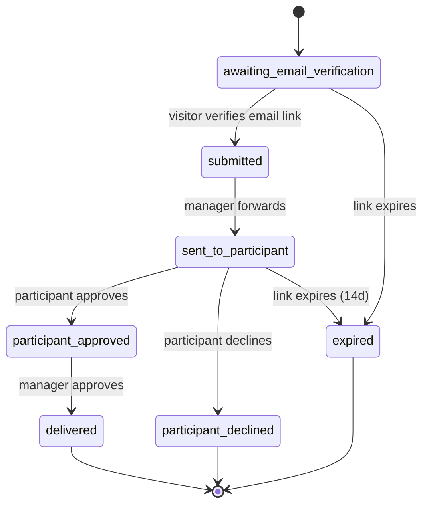
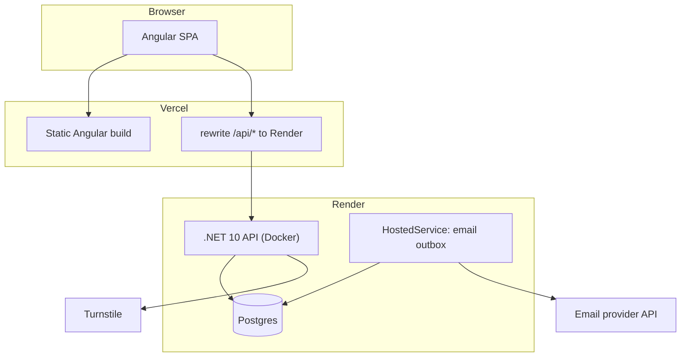
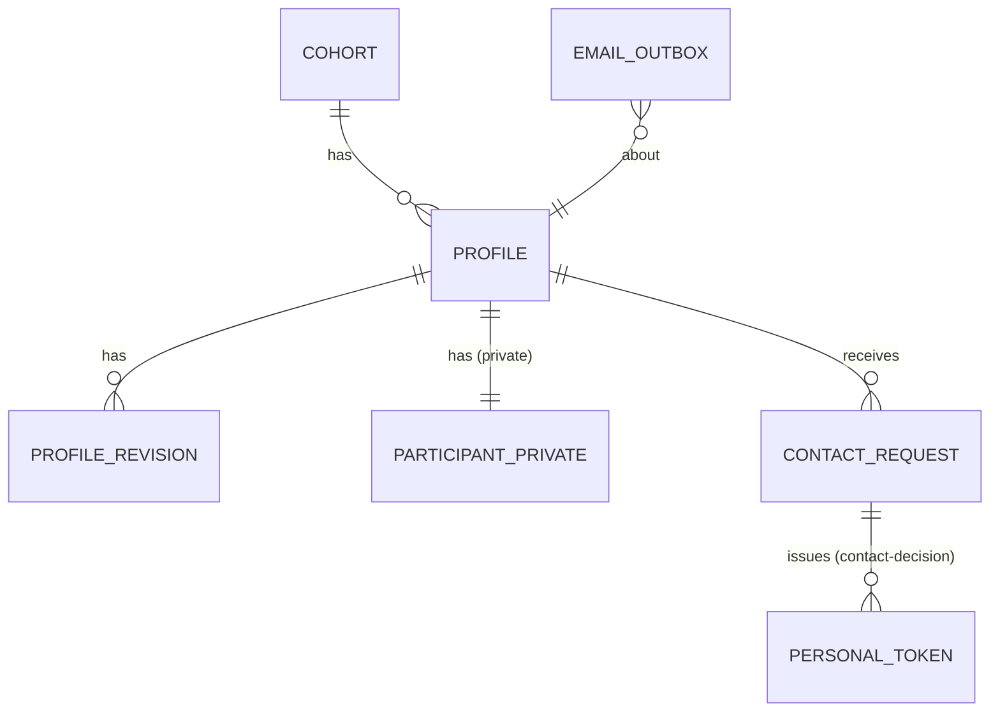

# Architecture Spine — אתר משתתפות ופרויקטים

## Design Paradigm

**Modular monolith בפרוסות אנכיות (vertical slices), עם הפרדה קשיחה בין מודל ציבורי למודל פרטי.** שרת אחד, בסיס נתונים אחד, מקוד אחד מחולק לפי פיצ'ר. אין מיקרו-שירותים.

| שכבה | מיקום | אחריות |
| --- | --- | --- |
| Web | `Api/` (נקודות קצה, אימות והרשאה) | מקבלת בקשות, בודקת הרשאה, מחזירה DTO |
| Application | `Features/<Feature>/` | תהליכי העבודה והכללים העסקיים של הפיצ'ר |
| Domain | `Domain/` | ישויות ומכונות מצבים. לא תלוי בכלום |
| Infrastructure | `Infrastructure/` | EF Core, מיילים, אחסון, שעון. ממשה ממשקים מ-Application |

## Invariants & Rules



הלקוח מדבר עם ה-API בלבד. ה-Web לא ניגש ל-Infrastructure ישירות. Domain לא מכיר אף אחד.

### AD-1 — מודל ציבורי נפרד מהמודל הפרטי, בבנייה [ADOPTED]

- **Binds:** FR-2, FR-4, FR-8, FR-13, FR-16, כל נקודות הקצה הציבוריות
- **Prevents:** חשיפה בטעות של מייל, נייד או פרטי בקשה בתגובה ציבורית.
- **Rule:** המייל והנייד נשמרים רק בטבלה הפרטית `ParticipantPrivate`. נקודות קצה ציבוריות מחזירות אך ורק `Public*` DTO ייעודיים שאין בהם שדות פרטיים, ולא ישות שמורה. אסור להחזיר ישות EF מנקודת קצה. בדיקת אוטומטית ב-CI שאף `Public*` DTO לא מכיל שדה פרטי.

### AD-2 — גרסאות פרופיל בלתי משתנות, גרסה ממתינה אחת [ADOPTED]

- **Binds:** FR-5, FR-7, FR-8, FR-12, FR-18
- **Prevents:** חשיפת טיוטה בציבור, ושינוי שמחליף גרסה מאושרת לפני אישור.
- **Rule:** כל הגשה היא שורה חדשה ב-`ProfileRevision` עם סטטוס `pending | approved | returned | superseded`. ל-`Profile` מצביע יחיד `ApprovedRevisionId`. האתר הציבורי קורא רק את הגרסה המאושרת. מותרת גרסה `pending` אחת לכל היותר לפרופיל: עריכה חדשה מסמנת את הקודמת `superseded` ויוצרת חדשה (באותה טרנזקציה). גרסה אינה נערכת אחרי יצירה. אישור משנה את המצביע בטרנזקציה אחת. אכיפה בבסיס הנתונים: אינדקס ייחודי חלקי המגביל ל-`pending` אחת לפרופיל (ראו AD-14). אישור או החזרה פועלים על `RevisionId` מפורש שהמנהלת ראתה, ונכשלים (409) אם הגרסה כבר אינה `pending`.

### AD-3 — בקשת פרטי קשר: מכונת מצבים, מסירה פעם אחת [ADOPTED]

- **Binds:** FR-13, FR-14, FR-15, FR-16
- **Prevents:** מסירת פרטי קשר בלי שני האישורים, או מסירה כפולה.
- **Rule:** מצבי `ContactRequest` ומעברים מותרים בלבד כמתואר. פרטי הקשר נשלחים רק כש-`ParticipantDecision = approved` **וגם** `ManagerApprovedAt` קיים, ורק בזמן שהפרופיל `Active` (ראו AD-13) וחלון ההסכמה לא פג (AD-17). `delivered` מסומן **רק אחרי שליחה בפועל** (AD-15, AD-16), לא בהכנסה לתור. המייל והנייד נקראים מ-`ParticipantPrivate` ברגע השליחה ולא מועתקים לבקשה או ל-Outbox. אישור משתתפת תקף לבקשה אחת בלבד. כל מעבר מצב הוא עדכון מותנה (AD-14).



### AD-4 — כל מייל יוצא דרך Outbox [ADOPTED]

- **Binds:** FR-11, FR-14, FR-15, FR-16, FR-18
- **Prevents:** מייל אבוד כשהשרת נופל, מייל כפול, או מייל שנשלח לפני שהטרנזקציה נשמרה.
- **Rule:** קוד עסקי לא קורא ל-API של הספק. הוא כותב שורה ל-`EmailOutbox` באותה טרנזקציה של השינוי העסקי, ובשורה **רק** `TemplateKey`, מזהי ישויות ו-`DeduplicationKey` ייחודי. **אין אסימון גולמי ואין מייל או נייד בשורה** (AD-15): הם נפתרים ברגע השליחה. תהליך רקע (HostedService) תופס שורות עם claim קצר (`FOR UPDATE SKIP LOCKED` ו-lease), מבצע את השליחה **מחוץ לטרנזקציה** דרך `IEmailSender` עם מפתח אידמפוטנטיות, ורק אז מסמן `sent`. מספר ניסיונות מוגבל. כשל סופי נכנס למצב `dead` שנראה למנהלת במסך הניהול. ספק המיילים מוחלף במימוש אחד של `IEmailSender` בלבד.

### AD-5 — שלוש זהויות והרשאה כברירת מחדל סגורה [ADOPTED]

- **Binds:** FR-6, FR-7, FR-11, FR-15, FR-17, FR-18, FR-19
- **Prevents:** נקודת קצה ניהולית שנשכחה פתוחה, או משתתפת שניגשת לפרופיל של אחרת.
- **Rule:** ברירת המחדל לכל נקודת קצה היא דרישת אימות (`FallbackPolicy`). נקודות ציבוריות מסומנות במפורש `[AllowAnonymous]`. שלוש זהויות: **Visitor** (אנונימי), **Participant** (כניסה עם גוגל, OpenID Connect בזרימת קוד; הזהות היא ה-`sub` של גוגל, ורק מייל מאומת מתקבל; ניגשת לפרופיל שלה בלבד; להחלטה בבקשת פרטי קשר אחת משמש אסימון קישור אישי תחום לאותה בקשה, AD-6), **Admin** (ASP.NET Core Identity, עוגיית אימות, תפקיד `Admin`). עוגיית סשן המשתתפת: `HttpOnly`, `Secure`, `SameSite=Lax`, עם anti-forgery בבקשות שינוי. הרשאה נאכפת בשרת בכל נקודת קצה, ולא רק בלקוח. משתמשי אדמין מוגדרים מראש (seed), בלי הרשמה עצמית.

### AD-6 — אסימוני קישור אישי [ADOPTED]

- **Binds:** FR-15
- **Prevents:** שימוש חוזר או שימוש בקישור למטרה אחרת, וגניבת אסימון מבסיס הנתונים.
- **Rule:** אסימון אקראי של 256 ביט, נשמר בבסיס הנתונים רק כ-hash, עם `Purpose`, הבקשה אליה הוא תחום, ותפוגה. המטרה היחידה היא `contact-decision`: 14 יום והחלטה אחת בלבד. עריכת פרופיל אינה משתמשת באסימון: היא נעשית בסשן של כניסה עם גוגל (AD-5). אסימון עם מטרה אחת נדחה בנקודת קצה של מטרה אחרת. לא נרשם ב-Log. האסימון מועבר בפרגמנט הכתובת (`#`) ולא בנתיב או בפרמטר, והלקוח מחליף אותו בעוגיית סשן קצרה ומנקה אותו מהכתובת. כותרת `Referrer-Policy: no-referrer`. פעולות הקישור (אישור, סירוב, עריכה) הן POST בלבד מאחורי מסך אישור, כי סורקי מייל מפעילים GET. צריכה היא עדכון מותנה אטומי (`UsedAt IS NULL`). הנפקת אסימון חדש מבטלת את הקודם לאותה מטרה.

### AD-7 — מקור אמת אחד לשיוך מחזור [ADOPTED]

- **Binds:** FR-1, FR-2, FR-10
- **Prevents:** פרופיל שמשויך למחזור לא קיים, או שמשתנה שיוך בדיעבד על ידי המשתתפת.
- **Rule:** המנהלת מנהלת רשימת `Cohort`. משתתפת מחוברת בוחרת מחזור מהרשימה ביצירת הפרופיל, ו-`CohortId` נקבע ביצירה. `Cohort` מחזיק `InviteToken` אופציונלי שממלא מראש את הבחירה בלבד (קישור שבוטל אינו ממלא מראש). רק המנהלת יכולה לשנות `CohortId` אחרי היצירה. נקודת קצה ציבורית מחזירה את רשימת המחזורים הפעילים בלי אסימונים.

### AD-8 — השרת חסר מצב, תמונות בבסיס הנתונים [ADOPTED]

- **Binds:** FR-3, FR-9
- **Prevents:** תלות בדיסק מקומי שנעלם בפריסה, ועבודת רקע כפולה בשני מופעים.
- **Rule:** אין כתיבה למערכת הקבצים של השרת. תמונת פרופיל שהועלתה מוקטנת בדפדפן עד כ-300KB ונשמרת כ-`bytea` ב-Postgres, ומוגשת דרך ה-API עם כותרות מטמון. אווטארים מוכנים הם נכסי לקוח המוצגים לפי מזהה דמות (`avatarId`), בלי אחסון. כל עבודת רקע ננעלת בבסיס הנתונים (SKIP LOCKED), כך ששני מופעים לא מבצעים אותה פעמיים.

### AD-9 — כתובת אחת לדפדפן [ADOPTED]

- **Binds:** all
- **Prevents:** בעיות עוגיות בין דומיינים, ועוגיות Admin חשופות ל-CORS.
- **Rule:** הדפדפן פונה רק לדומיין של Vercel. `/api/*` מועבר ל-Render דרך rewrite של Vercel. כתובת ה-callback של הכניסה עם גוגל היא תחת `/api/*` באותו דומיין, ונרשמת מול גוגל. אין CORS פתוח. עוגיית האימות `HttpOnly`, `Secure` (מוגדר במפורש `SecurePolicy=Always`), `SameSite=Lax`. השרת רץ עם `UseForwardedHeaders` וסומך רק על כותרות שמגיעות עם סוד משותף (`x-origin-secret`) ש-Vercel מוסיפה, ודוחה כל בקשה בלעדיו, כך שפנייה ישירה לכתובת של Render נחסמת. תגובות מאומתות מחזירות `Cache-Control: no-store`. לפני נעילה נדרש ניסוי כניסה מקצה לקצה של עוגיות דרך ה-rewrite (ספייק), הן לאדמין והן לכניסה עם גוגל (כולל ה-callback וה-`state`).

### AD-10 — קורות חיים הם טקסט, לא HTML [ADOPTED]

- **Binds:** FR-3, FR-8
- **Prevents:** XSS בעמוד ציבורי שמציג תוכן שהמשתמשת כתבה.
- **Rule:** קורות חיים ושאר טקסטים חופשיים נשמרים כ-**Markdown מוגבל** (כותרות, רשימות, הדגשה, קישורים). השרת מאמת אורך, מסיר HTML, ומאפשר בקישורים רק `http` ו-`https`. הלקוח מציג אותם דרך רנדרר בטוח, בלי `innerHTML` גולמי. אותו ניקוי חל על כל טקסט חופשי: קורות חיים, תיאור, תשובות היכרות וסיבת הפנייה של מבקר (גם במסך הניהול ובמיילים). אין קבצי קורות חיים בגרסה 1.

### AD-11 — מזהים ציבוריים אטומים

- **Binds:** FR-8, FR-9, FR-13
- **Prevents:** ניחוש מזהי פרופיל ובקשות רצופים.
- **Rule:** כל מזהה שיוצא מהשרת הוא GUID אקראי (v4), לא v7 (v7 מכיל זמן וניתן לניחוש חלקי). אין מזהה שלם רץ בכתובות או ב-DTO.

### AD-12 — הגנה על טפסים ציבוריים

- **Binds:** FR-2, FR-13
- **Prevents:** הצפת בקשות וספאם.
- **Rule:** הטפסים הציבוריים (בקשת פרטי קשר, והכניסה עם גוגל) דורשים אימות אנטי-בוטים בשרת (מועמד: Cloudflare Turnstile) והגבלת קצב לפי IP (נלקח מהכותרת המהימנה של AD-9) ולפי כתובת מייל, כשהמונים נשמרים בבסיס הנתונים ולא בזיכרון. הגשת פרופיל ועריכתו דורשות משתתפת מחוברת, והגבלת הקצב שלהן לפי חשבון (`GoogleSub`) ו-IP. אין בקשת קישור אישי לעריכה. אימות Turnstile נכשל סגור (כשל בבדיקה דוחה בקשה). יש תקרה גם לכל פרופיל ולכל משתתפת (בקשות פרטי קשר ומיילים), כדי שלא ניתן להציף תיבת דואר של משתתפת. כל המיילים טקסט פשוט בלבד, ושדות שנכנסים לכותרות מנוקים מתווי שורה חדשה. כתובת המבקר מאומתת בקישור חד-פעמי (`awaiting_email_verification`) לפני שהבקשה מגיעה למנהלת. הכתובת המאומתת ננעלת ואי אפשר לשנותה, והיא היחידה שאליה נשלחים פרטי קשר. סיבת הפנייה של המבקר היא טקסט פשוט בלי קישורים.

### AD-13 — מחזור חיים של פרופיל ושאילתה ציבורית יחידה

- **Binds:** FR-8, FR-19
- **Prevents:** פרופיל שהוסר שנשאר בגלריה, או שני נתיבי קריאה ציבוריים שמתפצלים.
- **Rule:** ל-`Profile` שדה `Visibility` (`active | removed`). שאילתה ציבורית אחת, `PublicProfileQuery`, מחזירה רק `Active` עם `ApprovedRevisionId`. כל נקודת קצה ציבורית עוברת דרכה. הסרה מבטלת אסימוני עריכה, ובקשות פרטי קשר פתוחות עוברות ל-`expired`.

### AD-14 — כל מעבר מצב הוא עדכון מותנה

- **Binds:** FR-7, FR-12, FR-15, FR-16, FR-18, FR-19
- **Prevents:** מרוצים: אישור גרסה שהוחלפה, אישור כפול, החלטה כפולה.
- **Rule:** כל שינוי סטטוס מבוצע כ-`UPDATE ... WHERE status = @expected` ובודק שורה אחת הושפעה, אחרת 409. אינדקס ייחודי חלקי: `ProfileRevision(ProfileId) WHERE status='pending'`. בדיקות מרוץ חובה לכל מעבר.

### AD-15 — אין סודות ב-Outbox

- **Binds:** FR-11, FR-15, FR-16
- **Prevents:** ביטול AD-1, AD-3 ו-AD-6 דרך עותק גלוי של אסימון או פרטי קשר בטבלת היוצא.
- **Rule:** שורת `EmailOutbox` מכילה `TemplateKey` ומזהים בלבד. אסימון חדש נוצר ופרטי הקשר נקראים ברגע השליחה, ותוכן המייל לא נשמר אחריה. הטבלה פרטית ולא נחשפת בשום DTO.

### AD-16 — אידמפוטנטיות ומצב שליחה אמיתי

- **Binds:** FR-16
- **Prevents:** מסירה כפולה, או `delivered` על מייל שלא נשלח.
- **Rule:** `DeduplicationKey` ייחודי (למשל `contact-delivery:{requestId}`). `delivered` נקבע רק אחרי הצלחת שליחה. כשל סופי נראה למנהלת ואפשר לנסות שוב ידנית.

### AD-17 — תוקף הסכמה ובדיקה מחדש בזמן מסירה

- **Binds:** FR-15, FR-16
- **Prevents:** מסירת פרטים על סמך הסכמה ישנה, או אחרי שהפרופיל הוסר או שהפרטים השתנו.
- **Rule:** הסכמת משתתפת תקפה 14 יום. בזמן המסירה נבדקים מחדש: הפרופיל `Active`, ההסכמה בתוקף, והמייל והנייד לא השתנו מאז ההסכמה (`ContactVersion`). מייל שהשתנה בחשבון הגוגל (נקרא מחדש בכניסה) מעלה את `ContactVersion` ועוצר מסירה שאושרה על המייל הקודם. אחרת המסירה נעצרת ומוצגת למנהלת.

### AD-18 — בעלות על `ParticipantPrivate` וזהות משתתפת

- **Binds:** FR-2, FR-11
- **Prevents:** חטיפת פרופיל, ופרופילים כפולים.
- **Rule:** `ParticipantPrivate` שייכת למודול הפרופילים בלבד, ורק מודול המסירה (AD-3) ומסך הניהול קוראים אותה. `GoogleSub` ייחודי ב-`Profile`: פרופיל אחד לכל חשבון גוגל. המייל נלקח מגוגל בכל כניסה ואינו ניתן לשינוי באתר. שינוי נייד בעריכה אינו חל מיד: הוא ממתין לאישור המנהלת. קישור הזמנה ניתן לביטול.

### AD-19 — תמונות הן חלק מהגרסה

- **Binds:** FR-3, FR-8
- **Prevents:** חשיפת תמונה של גרסה ממתינה, או קבצים מסוכנים.
- **Rule:** תמונה שייכת ל-`ProfileRevision` ומוגשת רק לפי `ApprovedRevisionId`. השרת מאמת סוג וגודל (לא רק הלקוח), מקודד מחדש ל-JPEG או WebP, שולח `X-Content-Type-Options: nosniff`, ולא מקבל SVG.

### AD-20 — הגנת כניסת אדמין ו-CSRF

- **Binds:** FR-17
- **Prevents:** ניחוש סיסמה, וזיוף בקשות בעוגיית אימות.
- **Rule:** סיסמת אדמין באורך 12 תווים לפחות עם בדיקת סיסמאות שדלפו. הגבלת ניסיונות כניסה ונעילה זמנית, ותגובת כניסה אחידה (בלי לגלות אם המשתמש קיים). עוגיית אדמין בשם `__Host-` עם `SameSite=Strict` ותוקף סשן מוגבל. כל בקשת שינוי מוגנת באסימון anti-forgery ובבדיקת `Origin`. לפחות שני משתמשי אדמין כדי שלא ננעלים בחוץ. אדמין ראשון נוצר בהפעלה רק אם אין אדמין קיים, מסיסמה חד-פעמית ממשתנה סביבה, וחובה להחליפה בכניסה הראשונה. אימות דו-שלבי (TOTP) לאדמין הוא חובה (FR-17).

### AD-21 — מפתחות הצפנה ותפקידים בבסיס הנתונים

- **Binds:** FR-11, FR-15, FR-17
- **Prevents:** התנתקות כל המשתמשים ואסימונים פגי תוקף בכל פריסה, והרשאות יתר של השרת.
- **Rule:** מפתחות ה-Data Protection של ASP.NET נשמרים בבסיס הנתונים (לא בקובץ מקומי), כי השרת חסר מצב. שני תפקידי בסיס נתונים: `migrator` (שינויי סכמה, רק בהרצת מיגרציות) ו-`app` (קריאה וכתיבה לנתונים בלבד).

### AD-22 — יומן ביקורת לפעולות ניהול

- **Binds:** FR-7, FR-15, FR-16, FR-18, FR-19
- **Prevents:** פעולה ניהולית על פרטי משתתפות שלא ניתן לברר מי ביצע ומתי.
- **Rule:** כל אישור, החזרה, הסרה, פנייה למשתתפת ומסירת פרטי קשר נרשמים ב-`AuditLog` עם זהות המבצע, זמן, סוג פעולה ומזהה ישות. ללא תוכן אישי בשורה.

## Consistency Conventions

| Concern | Convention |
| --- | --- |
| שמות | C# PascalCase, Angular `kebab-case` לקבצים ו-`camelCase` לשדות. ישויות ביחיד (`Profile`), טבלאות ב-snake_case |
| מזהים | GUID אקראי (v4) בכל מזהה שיוצא מהשרת. תאריכים ב-UTC, ISO 8601 ב-API. הלקוח ממיר לאזור זמן מקומי |
| שגיאות API | `application/problem+json` (RFC 9457). שגיאות אימות מחזירות רשימת שדות. אף שגיאה לא חושפת פרטים פנימיים |
| מעטפת תגובה | תגובה ישירה בלי מעטפת, עמוד תוצאות כ-`{ items, total }` |
| אימות קלט | FluentValidation או שווה ערך, בשרת. הלקוח רק מקל |
| שפה וכיוון | עברית ו-RTL: `dir="rtl"` בשורש. מאפייני CSS לוגיים (`margin-inline-*`). כל מחרוזת בקובץ משאבים אחד, לא בתוך קוד |
| רישום ביומן | Serilog ל-stdout, מובנה. אין מייל, נייד או אסימון ביומן |
| תצורה וסודות | משתני סביבה ב-Vercel וב-Render. אין סודות בקוד או בריפו |
| מיגרציות | EF Core migrations בקוד, מורצות בפריסה אוטומטית, בלי שינוי ידני בבסיס הנתונים |
| בדיקות | בדיקות יחידה לכללי Domain (מכונת מצבים, גרסאות), בדיקות אינטגרציה על Postgres אמיתי, ובדיקת AD-1 על כל ה-DTO הציבוריים |

## Stack

| Name | Version |
| --- | --- |
| .NET / ASP.NET Core | 10 (LTS, תמיכה עד 2028-11) |
| EF Core + Npgsql | 10.x, תואם .NET 10 |
| Postgres (Render managed) | הגרסה הנוכחית ב-Render בעת היצירה, לאשר |
| Angular | 22 (הגרסה העדכנית שאושרה, לאמת עם `ng version` ביצירת הפרויקט) |
| Node (לבניית Angular) | LTS הנוכחי |
| Vercel | לקוח סטטי ו-rewrite ל-API |
| Render | שירות Docker ל-.NET ובסיס נתונים מנוהל |
| ספק מיילים | מועמד: Resend, לאמת מחיר ותנאי דומיין לפני בחירה |
| אנטי-בוטים | מועמד: Cloudflare Turnstile |

## Structural Seed





**סביבות:** `local` (Docker + Postgres מקומי, תפסן מיילים), `preview` אופציונלית ב-Vercel מול Render dev, `production`. בפיתוח אפשר להשתמש בשכבה החינמית של Render. **לפרודקשן נדרשים שרת בתשלום ובסיס נתונים בתשלום:** השרת החינמי נרדם אחרי 15 דקות, ובסיס הנתונים החינמי נמחק אחרי 30 יום וללא גיבוי. דומיין מאומת לשליחת מיילים הוא חסם עלייה.

```text
resume_app/
  client/                 # Angular
    src/app/{public,participant,admin,shared}/
  server/                 # .NET
    Api/                  # endpoints, auth, DTOs (Public*, Admin*)
    Features/             # Profiles, Cohorts, ContactRequests, Auth, Email
    Domain/               # entities, state machines
    Infrastructure/       # EF Core, IEmailSender impl, outbox worker
    Tests/
  Dockerfile
  vercel.json             # rewrites
```

**מעטפת תפעול (v1):**
- **פריסה:** חיבור ל-GitHub. Vercel בונה את Angular אוטומטית, ו-Render בונה את ה-Dockerfile אוטומטית בכל דחיפה ל-`main`.
- **מיגרציות:** מורצות באתחול השרת תחת נעילת Postgres (advisory lock) כדי ששני מופעים לא יריצו במקביל. מיגרציה תואמת לאחור לגרסה הקודמת.
- **אזור:** שני השירותים באותו אזור באירופה, כמה שיותר קרוב.
- **בדיקת בריאות והתראה:** נקודת `/healthz`. אם `EmailOutbox` תקוע או יש שורות `dead`, מוצגת אזהרה במסך הניהול.
- **משתמש אדמין ראשון:** נוצר מהגדרות סביבה בהפעלה הראשונה.
- **גיבוי:** בסיס נתונים בתשלום ב-Render כולל שחזור לנקודת זמן (לאמת בתוכנית שנבחרה).

## Capability → Architecture Map

| Capability / Area | Lives in | Governed by |
| --- | --- | --- |
| FR-1 מחזורים וקישורי הזמנה | `Features/Cohorts` | AD-7 |
| FR-2..FR-5 הגשת פרופיל | `Features/Profiles` | AD-1, AD-2, AD-10, AD-12 |
| FR-6, FR-7, FR-18, FR-19 סקירת מנהלת | `Features/Profiles` (admin slice) | AD-2, AD-5 |
| FR-8..FR-10 אתר ציבורי | `Api/Public` + `client/public` | AD-1, AD-2, AD-11 |
| FR-11 כניסה עם גוגל | `Features/Auth` | AD-5, AD-9, AD-18 |
| FR-12 עדכון פרופיל | `Features/Profiles` | AD-2, AD-5 |
| FR-13..FR-16 בקשות פרטי קשר | `Features/ContactRequests` | AD-1, AD-3, AD-4, AD-6, AD-12 |
| FR-17 כניסת מנהלת | `Features/Auth` | AD-5, AD-9 |
| שליחת מיילים | `Features/Email`, `Infrastructure` | AD-4 |

## Launch Conditions

תנאים לעלייה לאוויר, לא לפיתוח:

- **דומיין מאומת** לשליחת מיילים (SPF ו-DKIM).
- **שרת ובסיס נתונים בתשלום** ב-Render, באזור אירופה, עם שחזור לנקודת זמן.
- **החלטה כתובה של הארגון** על אחסון פרטי משתתפות אצל ספקים בחו"ל, כולל הסכם עיבוד נתונים עם כל ספק (Vercel, Render, ספק המיילים) והתאמה לחוק הגנת הפרטיות. [NOTE: לבדיקה משפטית, לא נבדק כאן.]
- **מדיניות שמירה ומחיקה** מאושרת.
- **אדמין עם אימות דו-שלבי** ולפחות שני משתמשי אדמין.
- **ספייק עוגיות:** כניסת אדמין וכניסה עם גוגל מקצה לקצה דרך ה-rewrite של Vercel (AD-9).
- **פרויקט OAuth בגוגל:** מסך הסכמה, דומיין מאושר, כתובת callback רשומה, והסוד נשמר בצד השרת בלבד. הגבלה מוכרת: משתתפת בלי חשבון גוגל אינה יכולה ליצור פרופיל בגרסה 1.

## Deferred

- **מדיניות שמירה ומחיקת נתונים:** מחכה להחלטת מנהלת הקורס (PRD, שאלה 6), ומשפיעה על הסכמה ועל דיני הגנת הפרטיות. עד אז `removed` אינו מוחק נתונים.
- **אישור הארגון לאחסון נתונים בחו"ל (Vercel ו-Render):** שאלה פתוחה, יש לברר לפני עלייה.
- **צפייה והתראות תפעוליות (Observability):** רק ביומן stdout ב-v1. כלי ניטור נוסף אחר כך.
- **העלאת קורות חיים כקובץ ואחסון קבצים חיצוני:** לא בגרסה 1.
- **SSR ו-SEO לקידום אורגני:** לא בגרסה 1.
- **בחירה סופית של ספק המיילים והדומיין:** בלי דומיין אי אפשר לעלות, אך אפשר לפתח.
- **ניהול משתמשי אדמין ואיפוס סיסמה:** נקבע ב-v1 כהגדרה ידנית, אין ממשק.
